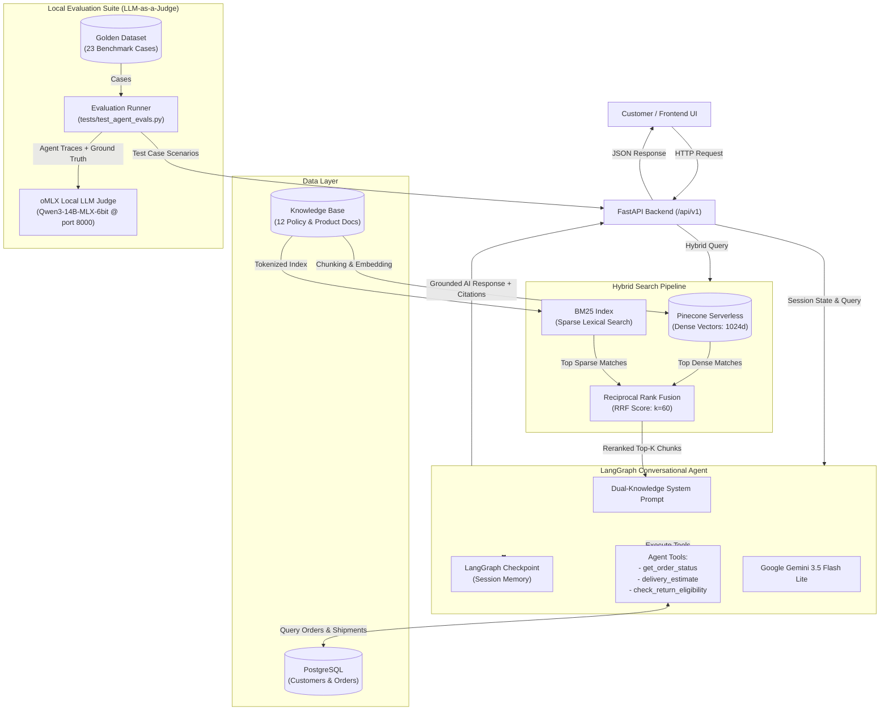

# NovaGear — AI-Powered E-Commerce Platform, Dual-Knowledge Agent & Evaluation Suite

NovaGear is an end-to-end e-commerce platform and intelligent customer concierge built for premium gear, audio hardware, ergonomic workspace accessories, and smart devices.

The system combines a high-performance **FastAPI** backend, a **PostgreSQL** relational database for live customer orders, a **Dual-Knowledge LangGraph Agent** integrating live operational tools with an advanced **Hybrid Retrieval-Augmented Generation (RAG)** pipeline (Google Gemini embeddings, Pinecone Vector Store, and BM25 lexical search with Reciprocal Rank Fusion), and an automated **LLM-as-a-Judge Evaluation Suite** running locally via **oMLX**.

---

## Architecture Overview



---

## Key Features

### 1. Dual-Knowledge Architecture
The agent dynamically blends two distinct sources of truth:
- **Static Catalog & Store Policies (Hybrid RAG):** Detailed product specs, dimensions, troubleshooting guides, warranty coverage, and return rules grounded in markdown documentation with verified citation metadata.
- **Live Customer & Operational Tools (Relational Database):**
  - `get_order_status`: Real-time order fulfillment status, line items, and totals.
  - `delivery_estimate`: Precise business day delivery date windows based on customer shipping tiers (Standard, Expedited, Priority).
  - `check_return_eligibility`: Dynamic calculation factoring product categories (strict 14-day window for opened electronics vs. 30-day standard window for furniture/accessories) with automatic fallback to the NovaGear 2-Year Limited Hardware Warranty.

### 2. Hybrid Search with Reciprocal Rank Fusion (RRF)
Fuses dense vector embeddings (`models/gemini-embedding-001`, 1024 dimensions) with sparse keyword matching (`rank-bm25`) to handle both complex semantic queries and exact keyword lookups (SKUs, part numbers, warranty codes) using Reciprocal Rank Fusion ($k=60$).

### 3. Automated LLM-as-a-Judge Evaluation Suite
- **23-Case Golden Dataset:** 12 live database tool scenarios and 11 static knowledge RAG scenarios covering order tracking, category-specific return rules, freight fulfillment, and warranty claims.
- **4-Metric Structured Grading:** Every interaction is judged on:
  - **Relevance:** Does the response address the customer's query directly?
  - **Correctness:** Does the response align with atomic ground truth facts?
  - **Faithfulness:** Are all stated claims grounded in tool outputs or retrieved context (zero hallucinations)?
  - **Helpfulness:** Is the tone professional, structured, and actionable?
- **Zero-Cost Local Inference:** Powered by **oMLX** on Apple Silicon (`Qwen3-14B-MLX-6bit` with 40k token context window), eliminating API rate limits and token costs during automated testing.

### 4. Multi-Turn Session Memory
State checkpointers powered by LangGraph preserve conversation history per session (`session_id`), allowing contextual follow-ups without context drift.

### 5. Interactive Editorial Storefront
Modern client-side storefront featuring customer persona switching, live order viewing, product showcases, and a collapsible concierge drawer with real-time markdown rendering and source citations.

---

## Tech Stack

| Component | Technology | Description |
|---|---|---|
| **Backend Framework** | FastAPI (Python 3.11+) | Async API routing, CORS, and dependency injection |
| **ASGI Server** | Uvicorn | High-performance asynchronous execution |
| **Agent Orchestration** | LangChain 0.3+, LangGraph | Dual-knowledge state graph, tool invocation & checkpointers |
| **LLM (Agent)** | Google Gemini (`gemini-3.5-flash-lite`) | Primary agent model for reasoning and tool calling |
| **Embeddings** | Google Gemini (`models/gemini-embedding-001`) | 1024-dimensional dense document and query vectors |
| **Vector Database** | Pinecone Serverless | Cosine distance metric, dense semantic index |
| **Lexical Search** | BM25 (`rank-bm25`) | In-memory tokenized BM25 index |
| **Relational Database** | PostgreSQL via SQLAlchemy 2.0 | Customers, orders, items, shipping tracking |
| **Local Evaluation Judge** | oMLX (`Qwen3-14B-MLX-6bit`) | Local Apple Silicon MLX inference for automated evaluation |
| **Data Validation** | Pydantic v2 | Request/response DTOs and structured judge schemas |
| **Frontend** | Vanilla HTML5 / CSS3 / ES6 JavaScript | Minimalist editorial UI with persona switcher & chat drawer |

---

## Project Structure

```
ecommerce/
├── agents/                     # LangGraph agent definitions, prompts & tools
│   ├── tools/
│   │   └── order_tool.py       # Live DB tools (status, delivery, returns)
│   ├── graphs.py               # Agent graph, checkpointer, and LLM configuration
│   └── system_prompt.py        # Dual-knowledge concierge system instructions
├── api/
│   └── v1/
│       ├── chat.py             # Chat endpoint (/api/v1/chat)
│       └── customer.py         # Customer and order CRUD endpoints
├── config.py                   # Centralized environment variable loader
├── db/
│   ├── db.py                   # SQLAlchemy engine and session dependencies
│   └── db_model.py             # Customer & Order relational models
├── frontend/                   # Editorial client-side storefront
│   ├── index.html              # Storefront with concierge drawer
│   ├── style.css               # Design system & styles
│   └── app.js                  # Frontend state, API integration, and chat logic
├── knowledge/                  # Production markdown documentation
│   ├── orders_and_billing/     # Order tracking, payment methods, loyalty
│   ├── policies/               # Returns, shipping, warranty, privacy
│   ├── products/               # Product catalog, sizing, troubleshooting
│   └── support/                # FAQs, contact and escalation procedures
├── models/                     # Pydantic schemas (DTOs)
│   ├── ai_response.py          # Chat response schema with citation sources
│   ├── chat_request.py         # User prompt request payload
│   ├── models.py               # Customer and order schemas
│   └── search_result_item.py   # RRF retrieved chunk schema
├── scripts/
│   ├── ingest.py               # Markdown document chunker
│   ├── pine.py                 # Pinecone index provisioning script
│   └── pinecone_ingest.py      # Batch embedder and Pinecone uploader
├── services/
│   ├── chat_service.py         # RAG + agent execution pipeline
│   └── rag_service.py          # Hybrid search and Reciprocal Rank Fusion
├── tests/                      # LLM-as-a-Judge Evaluation Suite
│   ├── eval_judge.py           # oMLX local evaluation judge client
│   ├── eval_schemas.py         # Pydantic schemas for evaluation metrics & traces
│   ├── golden_dataset.json     # 23 benchmark test cases with ground truth facts
│   └── test_agent_evals.py     # Evaluation runner and reporter
├── main.py                     # FastAPI application entrypoint & lifespan
├── requirements.txt            # Python dependencies
├── .env.example                # Sample environment configuration template
└── .gitignore                  # Git ignore rules
```

---

## Getting Started

### 1. Prerequisites
- **Python 3.11+**
- **PostgreSQL** running locally or in Docker
- **Google Gemini API Key** ([Google AI Studio](https://aistudio.google.com/))
- **Pinecone API Key** ([Pinecone Console](https://app.pinecone.io/))
- *(Optional for evaluations)* **oMLX** or any local OpenAI-compatible inference server running an instruction-tuned model (e.g. `Qwen3-14B-MLX-6bit`)

### 2. Clone the Repository
```bash
git clone https://github.com/rahulrajesh21/hybrid-rag-ecommerce-agent.git
cd hybrid-rag-ecommerce-agent
```

### 3. Create & Activate Virtual Environment
```bash
python3 -m venv .venv
source .venv/bin/activate
```

### 4. Install Dependencies
```bash
pip install -r requirements.txt
```

### 5. Configure Environment Variables
Copy `.env.example` to `.env`:
```bash
cp .env.example .env
```

Configure your credentials in `.env`:
```env
# Google Gemini
GOOGLE_API_KEY="your-google-api-key"

# Pinecone Vector Store
PINECONE_API_KEY="your-pinecone-api-key"
INDEX_NAME="novagear-support"
NAMESPACE="policies"

# PostgreSQL Database
DB_NAME="NovaGear"
DB_PASSWORD="your-postgres-password"

# Optional: Local LLM Evaluation Judge (oMLX)
OMLX_BASE_URL="http://127.0.0.1:8000/v1"
OMLX_API_KEY="oMLX"
OMLX_MODEL="Qwen3-14B-MLX-6bit"
```

### 6. Setup PostgreSQL Database
Ensure your PostgreSQL server is running and create the database:
```sql
CREATE DATABASE "NovaGear";
```
*(Tables and schemas are automatically created on startup via FastAPI's lifespan handler).*

### 7. Provision Pinecone & Ingest Documentation
Run the helper scripts to create the Pinecone Serverless vector index and ingest the 12 knowledge documents:
```bash
# 1. Create Pinecone Index (1024 dimensions, Cosine metric)
python -m scripts.pine

# 2. Ingest & Embed Markdown Knowledge Base
python -m scripts.pinecone_ingest
```

---

## Running the Application

### 1. Start the FastAPI Backend
```bash
python -m uvicorn main:app --reload
```
The API server starts at `http://127.0.0.1:8000`. Interactive OpenAPI documentation is accessible at `http://127.0.0.1:8000/docs`.

### 2. Launch the Frontend
Serve the static storefront using any local HTTP server:
```bash
# In a separate terminal tab:
python3 -m http.server 3000 --directory frontend
```
Open `http://localhost:3000` in your browser.

---

## Running the Evaluation Suite (LLM-as-a-Judge)

The evaluation suite automatically grades the agent's behavior across 23 test cases, verifying tool invocation accuracy, retrieval relevance, factual correctness, hallucination resistance, and conversational helpfulness.

### 1. Start Local Inference Server (oMLX)
Start your local oMLX server (or equivalent OpenAI-compatible server):
```bash
# Example oMLX launch with Qwen3-14B-MLX-6bit on port 8000
omlx --model Qwen3-14B-MLX-6bit --port 8000
```

### 2. Run the Benchmark Suite
Run the evaluation test suite:
```bash
python -m tests.test_agent_evals
```

### Sample Evaluation Output:
```text
=======================================================
RUNNING NOVA-GEAR EVALUATION SUITE (23 CASES)
=======================================================

[1/23]  PASS [TC-TOOL-001] - Where is my order ORD-6520?
    • Tool Invoked: get_order_status (Expected: get_order_status) -> OK
    • Relevance:    5/5 (The final answer directly addresses the user's question...)
    • Correctness:  5/5 (The answer correctly states that order ORD-6520 is for...)
    • Faithfulness: 5/5 (All claims in the final answer are grounded in the tool output...)
    • Helpfulness:  5/5 (The response is clear, polite, and offers actionable next steps...)

...

=======================================================
 SUMMARY: 23/23 Passed (100.0%)
=======================================================
```

---

## API Reference

### Concierge Chat
- **`POST /api/v1/chat`**
  - **Body:**
    ```json
    {
      "message": "When will my order ORD-9430 be delivered?",
      "customer_id": "CUST-002",
      "session_id": "session-1234"
    }
    ```
  - **Response:**
    ```json
    {
      "answer": "Your order ORD-9430 for the NovaBeam Monitor Lightbar is scheduled for delivery between November 21 and November 24, 2026 via Standard shipping.",
      "session_id": "session-1234",
      "sources": [
        {
          "content": "...",
          "metadata": {
            "source": "policies/shipping_policy.md",
            "filename": "shipping_policy.md"
          }
        }
      ]
    }
    ```

### Customers & Orders
- **`GET /api/v1/users`**: List all customer accounts.
- **`POST /api/v1/customers`**: Create a new customer profile.
- **`GET /api/v1/customers/{customer_id}`**: Fetch customer profile along with their order history.
- **`POST /api/v1/customers/{customer_id}/orders`**: Place a new order for a customer.

---

## License

This project is licensed under the MIT License.
