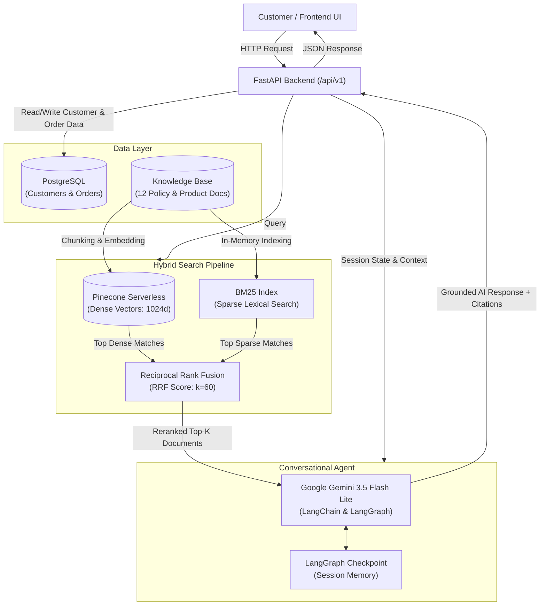

# NovaGear — AI-Powered E-Commerce Store & Hybrid RAG Concierge

NovaGear is an end-to-end e-commerce platform and intelligent customer concierge built for premium gear, audio, ergonomic workspace accessories, and everyday carry essentials.

The system combines a high-performance **FastAPI** backend, a **PostgreSQL** relational database for customer orders, and an advanced **Hybrid Retrieval-Augmented Generation (RAG)** pipeline leveraging **Google Gemini**, **Pinecone Vector Store**, and **BM25 Lexical Search** with **Reciprocal Rank Fusion (RRF)**.

---

## Architecture Overview



---

## Key Features

- **Hybrid Search with Reciprocal Rank Fusion (RRF):** Fuses dense vector embeddings (`gemini-embedding-2`, 1024 dimensions) with sparse keyword matching (`rank-bm25`) to handle both semantic queries and exact keyword lookups (SKUs, part numbers, policy codes).
- **Multi-Turn State with LangGraph:** State checkpointers preserve conversation history per session (`session_id`), allowing continuous natural dialogues.
- **Relational Customer & Order Management:** Fully modeled PostgreSQL relational schema with SQLAlchemy for customers and order records.
- **Grounded Concierge with Citation Metadata:** Citations and source documents are returned alongside each AI answer, guaranteeing answers adhere to store policies.
- **Modern Editorial Storefront:** Vanilla HTML/CSS/JavaScript storefront with a customer persona switcher, interactive product showcase, and a floating, collapsible concierge drawer.

---

## Tech Stack

| Component | Technology |
|---|---|
| **Backend Framework** | FastAPI (Python 3.11+) |
| **ASGI Server** | Uvicorn |
| **LLM & Embeddings** | Google Gemini (`gemini-3.5-flash-lite`, `gemini-embedding-2`) |
| **Agent Framework** | LangChain 0.3+, LangGraph |
| **Vector Database** | Pinecone Serverless (Cosine Metric, 1024 dimensions) |
| **Lexical Search** | BM25 (`rank-bm25`) |
| **Relational Database** | PostgreSQL via SQLAlchemy 2.0 & Psycopg2 |
| **Data Validation** | Pydantic v2 |
| **Frontend** | Vanilla HTML5, CSS3, JavaScript (Fetch API, responsive design) |

---

## Project Structure

```
ecommerce/
├── agents/                     # LangGraph agent definitions & prompts
│   ├── graphs.py               # Gemini LLM and embedding configurations
│   └── system_prompt.py        # System instructions and brand voice
├── api/
│   └── v1/
│       ├── chat.py             # Chat concierge route (/api/v1/chat)
│       └── customer.py         # Customer and order endpoints
├── config.py                   # Centralized environment variable loader
├── db/
│   ├── db.py                   # SQLAlchemy engine and session dependency
│   └── db_model.py             # Customer & Order table models
├── frontend/                   # Client-side storefront
│   ├── index.html              # Main storefront with drawer modal
│   ├── style.css               # Modern editorial styles
│   └── app.js                  # API integration, persona switcher, chat drawer
├── knowledge/                  # Production knowledge base
│   ├── orders_and_billing/     # Order tracking, payment methods, loyalty
│   ├── policies/               # Returns, shipping, warranty, privacy
│   ├── products/               # Product catalog, sizing, troubleshooting
│   └── support/                # FAQs, contact and escalation procedures
├── models/                     # Pydantic schemas (DTOs)
│   ├── ai_response.py          # Chat response schema with citation sources
│   ├── chat_request.py         # User prompt request payload
│   ├── models.py               # Customer and order schemas
│   └── search_result_item.py   # RRF retrieved chunk schema
├── scripts/
│   ├── ingest.py               # Markdown 2-stage chunker
│   ├── pine.py                 # Pinecone index creation script
│   └── pinecone_ingest.py      # Batch uploader to Pinecone
├── main.py                     # FastAPI application entrypoint & lifespan
├── requirements.txt            # Python dependencies
├── .env.example                # Sample environment configuration
└── .gitignore                  # Git ignore rules
```

---

## Getting Started

### 1. Prerequisites
- **Python 3.11+** installed
- **PostgreSQL** running locally or in Docker
- **Google Gemini API Key** ([Google AI Studio](https://aistudio.google.com/))
- **Pinecone API Key** ([Pinecone Console](https://app.pinecone.io/))

### 2. Clone the Repository
```bash
git clone <your-repository-url>
cd ecommerce
```

### 3. Create & Activate Virtual Environment
```bash
python3 -m venv .venv
source .venv/bin/activate
```

### 4. Install Dependencies
```bash
pip install -r requirements.txt
```

### 5. Configure Environment Variables
Copy `.env.example` to `.env`:
```bash
cp .env.example .env
```
Fill in your credentials in `.env`:
```env
GOOGLE_API_KEY="your-google-api-key"
PINECONE_API_KEY="your-pinecone-api-key"
INDEX_NAME="novagear-support"
NAMESPACE="policies"
DB_NAME="NovaGear"
DB_PASSWORD="your-postgres-password"
```

### 6. Create PostgreSQL Database
Ensure your PostgreSQL server is running and create the database specified in `.env`:
```sql
CREATE DATABASE "NovaGear";
```
*(Tables are automatically created on startup via FastAPI's lifespan handler).*

### 7. Create Pinecone Index
Run the helper script to create the Pinecone Serverless vector index configured for 1024 dimensions:
```bash
python -m scripts.pine
```

### 8. Ingest the Knowledge Base into Pinecone
Chunk and vectorize the 12 documentation files into your Pinecone index:
```bash
python -m scripts.pinecone_ingest
```

---

## Running the Application

### 1. Start the FastAPI Backend
```bash
python -m uvicorn main:app --reload
```
The API server will start at `http://127.0.0.1:8000`. You can inspect the interactive OpenAPI documentation at `http://127.0.0.1:8000/docs`.

### 2. Launch the Frontend
You can serve the static frontend using any standard static file server or Python's built-in HTTP server:
```bash
# In a separate terminal tab:
python3 -m http.server 3000 --directory frontend
```
Open `http://localhost:3000` in your browser.

---

## API Reference

### Concierge Chat
- **`POST /api/v1/chat`**
  - **Body:**
    ```json
    {
      "message": "What is your return policy for open-box headphones?",
      "session_id": "session-1234"
    }
    ```
  - **Response:**
    ```json
    {
      "answer": "Our return policy allows returns within 30 days...",
      "session_id": "session-1234",
      "sources": [
        {
          "content": "...",
          "metadata": {
            "source": "policies/return_and_refund_policy.md",
            "filename": "return_and_refund_policy.md"
          }
        }
      ]
    }
    ```

### Customer & Orders
- **`GET /api/v1/users`**: List all existing customers.
- **`POST /api/v1/customers`**: Create a new customer profile.
- **`GET /api/v1/customers/{customer_id}`**: Fetch customer profile along with their order history.
- **`POST /api/v1/customers/{customer_id}/orders`**: Create a new order for a specific customer.

---

## License

This project is licensed under the MIT License.
